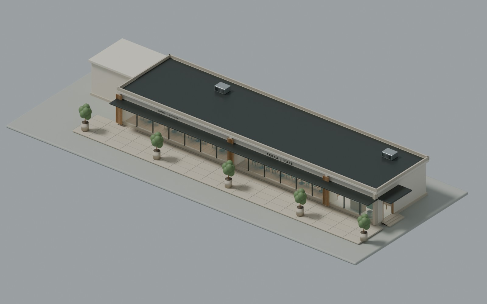

# TERRA — одноэтажное кафе

**[Открыть интерактивную 3D-модель](https://simaleee.github.io/Sozdano_intelekt/)**

Дизайнерская концепция кафе по фотографии плана заказчика. Модель создана в Blender: два зала, две кухни, входной холл, санузлы и хозяйственный блок. Дизайн: природный камень, дуб, зелёная обивка, бронзовые детали и тёплое освещение.

## Просмотр

- Вращение мышью или пальцем, масштабирование колесом / двумя пальцами.
- Кнопки «Без крыши» и «План сверху» открывают интерьер.
- «Кофейный зал» и «Основной зал» — просмотр с уровня глаз. Тяните мышью для осмотра, WASD / стрелки для движения. На телефоне используйте экранные стрелки.
- Переключатели крыши, фасада, автоповорота и подписей помещений.
- Внутри движение свободное, без проверки столкновений. Esc возвращает наружу.

## Файлы

- [Редактируемый Blender-проект](model/terra-cafe.blend)
- [Универсальная модель GLB](model/terra-cafe.glb)
- [Скрипт генерации](model/create_cafe.py)
- [Интерьер без крыши](interior.jpg)

Скрипт рассчитан на Blender 4.5.0: `blender -b --python model/create_cafe.py`. Он пересоздаёт модель, исходник и две визуализации в этом каталоге.

Для локального просмотра: `python -m http.server 8080`, затем откройте `http://localhost:8080`. Зависимости Three.js r170 включены в `vendor/`, внешние CDN и аналитика не используются.

## Точность

Это визуальная концепция, а не обмерная модель. На исходной экспликации указано 267,1 м². Сохранены назначение помещений и общая вытянутая структура с боковым служебным блоком, но размеры и проёмы восстановлены приблизительно по фотографии. Площади модели не сверены с обмерами. Панорамное остекление, фасад, материалы и мебель предложены как дизайн. Для реализации нужны обмеры и рабочая документация. Фотография исходного плана не публикуется.

Three.js распространяется по лицензии MIT, см. `vendor/LICENSE-three.txt`.
